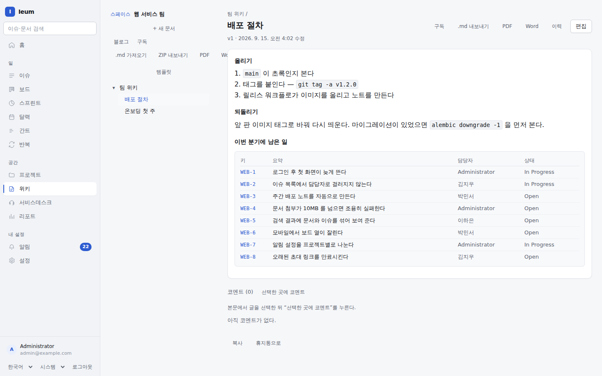
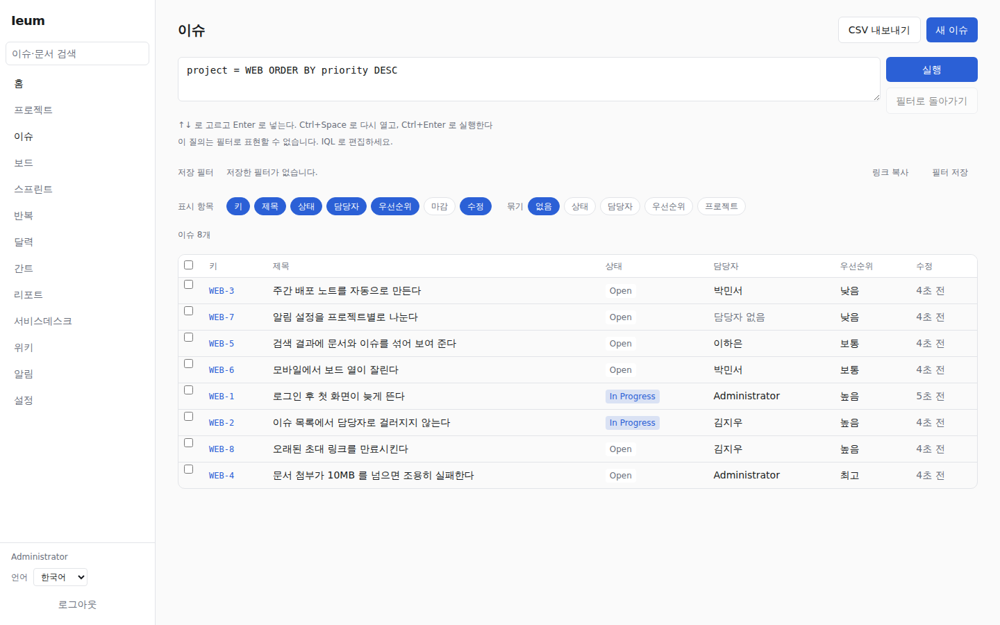
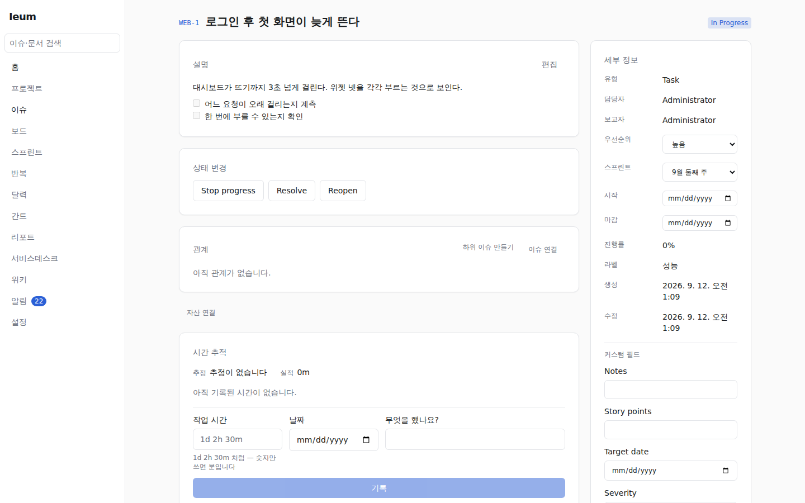
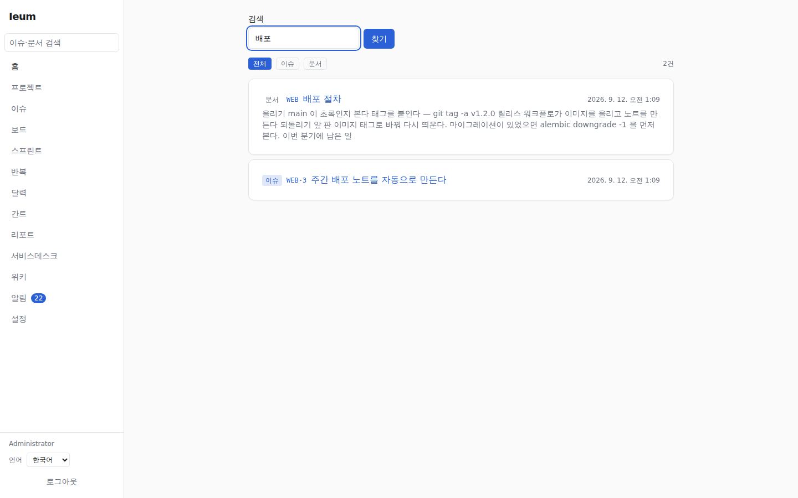
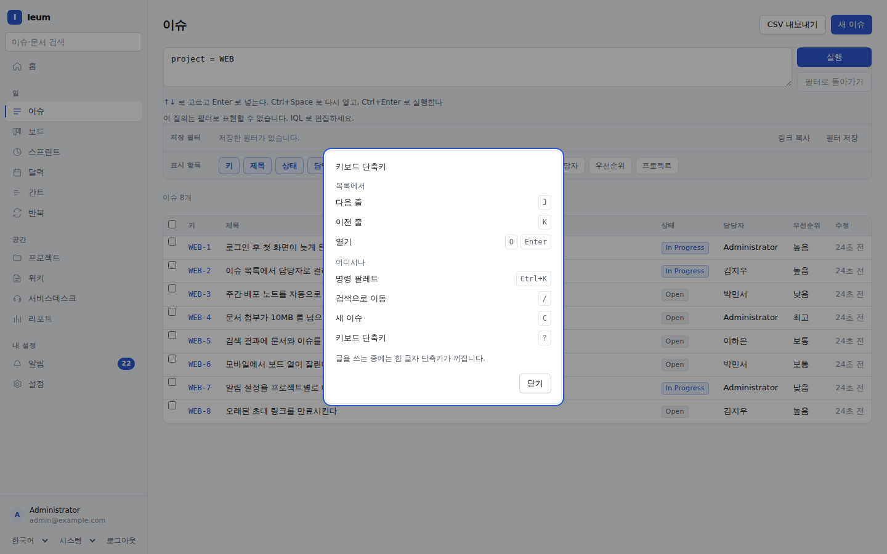
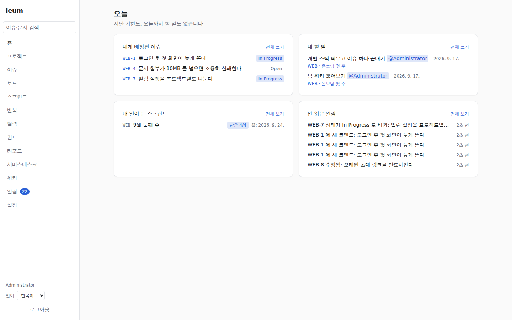

# Ieum (이음)

**English** · [한국어](README.ko.md)

> *Ieum* (이음) is Korean for "that which joins" — it joins your scattered issues,
> docs, and requests into one place.
> Pronounced **ee-eum**.

A **self-hosted** team collaboration platform that replaces Jira, Confluence, and
Jira Service Management. The whole thing runs on your own server, with no external
SaaS.

📖 **[Manual — from installation to everyday use](https://pan889.github.io/Ieum/en/)**



The three products share **one permission model, one search, and one notification
system**. The pages attached to an issue and the issues attached to a page come up
in the same search box and follow the same role settings.

- **Issues** — project hierarchy, custom fields, workflows, time tracking, Gantt
  and calendar views, issue links, saved filters, Kanban, sprints
- **Wiki** — spaces and page trees, version diffs, inline comments, templates,
  macros, real-time co-editing, `.md` import and export
- **Service Desk** — customer portal, request types, queues, SLAs, email channel,
  approval gates, CSAT

---

## Screenshots

*The screenshots show the Korean UI. Ieum ships in English as well.*

### Every list is a query

Issue lists, queues, saved filters, and the issue tables inside pages **all speak
the same query language (IQL)**. A query you build in one place can be pasted into
any of the others.



### A single issue

Descriptions are Markdown, and checkboxes in the body count as to-dos. Status only
moves along **the transitions the workflow allows** — you can't jump to an
arbitrary status.



### Pages know about issues

Write `::issues{query="..."}` in a page and it becomes a **live table**. The
"이번 분기에 남은 일" (*left to do this quarter*) table in the screenshot at the top
is one of these — not a list someone typed up, but the result of a query run each
time the page opens.

### One search box for both

Issues and pages come back mixed in a single result list. Korean text is indexed
by morpheme (PGroonga).



### Keyboard first

`Cmd/Ctrl+K` for the command palette, `c` for a new issue, `/` to search,
`j`/`k`/`o` to move through lists, and `e`·`a`·`s`·`p` on an issue. **`?` shows
only the shortcuts that actually work on the current screen.**

Single-key shortcuts switch off while you're typing — typing "create" in a comment
won't make `c` open a new issue.



### What you see when you sign in



---

## Try it

All you need is Docker and Compose (v2), and it's up with a single command.

```bash
curl -fsSLO https://raw.githubusercontent.com/pan889/Ieum/v1.2.2/deploy/install/install.sh
sh install.sh --url https://ieum.example.com
```

The installer asks for **just one thing: the URL**. It generates the secret key,
database password, and storage keys on the spot and writes them to `.env` (mode
0600), migrates the schema, creates an admin account, and then prints the URL and
the initial password. Upgrading is the same command
(`sh install.sh --version 1.2.2`) — your existing secrets are kept, not regenerated.

**Only one port is exposed.** The UI, the API, and attachments are all served from
the same origin, so when you put TLS in front there's exactly one thing to point
it at.

Images are **pulled, not built** (`ghcr.io/pan889/ieum-api`, `ieum-web`). We can
only answer "what exactly is running?" if you and we are running the same bytes.

→ **[Install guide](deploy/install/README.md)** (Korean) — running behind a proxy,
upgrading, what to back up, and what this installer **doesn't** do. The
[English manual](https://pan889.github.io/Ieum/en/) covers installing and upgrading
too.
→ To scale out across several nodes, see the [Helm chart](deploy/helm/ieum/).

## Hack on it

This runs Ieum from source. The code is mounted into the containers, so your edits
take effect right away.

```bash
git clone https://github.com/pan889/Ieum.git && cd Ieum
cp .env.example .env
make secret          # put the printed value into IEUM_SECRET_KEY in .env
make dev             # starts Postgres, Redis, MinIO, the API, the worker, and the web app
```

Open <http://localhost:5173> and sign in with the admin account you set in `.env`.

## First steps

| | |
|---|---|
| Create a project | **Projects** in the sidebar → New project. Its key (`WEB`) becomes the prefix of every issue number |
| Invite people | Invite them from **Settings → People**. SSO (OIDC, SAML) and SCIM live here too |
| Open a wiki space | **Wiki** → New space. You can upload a bundle of `.md` files as is |
| Set up a customer portal | **Settings → Portals**. Each request type is a form, and incoming requests land in a queue under **Service Desk** |

Press `?` on any screen to see **the shortcuts that actually work on that screen**.
If you get stuck anywhere, let us know in an issue.

## Migrating in

There's an adapter for moving projects over from Redmine. **The Ieum server never
reaches out to the source system** — an admin exports a bundle on their own machine
and uploads it. For our server to call someone else's Redmine, it would have to
hold that instance's URL and API key, which is both an SSRF vector and
**someone else's credentials sitting in our database**. The adapter uses only the
Python standard library, because the admin's machine has neither our server nor
any third-party packages on it.

```bash
export REDMINE_API_KEY=...      # command-line arguments show up in the process list
uv run --project apps/api python -m ieum.migrate.redmine \
    --url https://redmine.example.com --project my-project --out my-project.zip
```

There are no Jira, Confluence, or Zammad adapters yet, and the receiving side (the
screen that loads a bundle) is still being built — the "빠진 것" (*What's missing*)
section of the [CHANGELOG](CHANGELOG.md) (Korean) has the current status.

## For contributors

```bash
make test            # 3,041 API tests + 580 web unit tests
pnpm --filter @ieum/web exec playwright test    # 267 browser tests
```

| | |
|---|---|
| List of commands | `make help` |
| Full check before committing | `make check` (ruff · mypy --strict · bandit · tests · i18n) |
| Local stack | `make dev` · `make infra` · `make reset-db` |
| Deployment | [`deploy/install/`](deploy/install/) (one-liner) · [`deploy/compose/`](deploy/compose/) (build from source) · [`deploy/helm/`](deploy/helm/ieum/) |

What changed in each release — and **how much of it was actually verified** — is
in [CHANGELOG.md](CHANGELOG.md) (Korean). That matters more than the feature list:
"implemented" and "actually works that way" are not the same thing, and the gap
between them has caused more breakage in this project than anything else.

There's a dev blog that walks through those failures one at a time —
**[Peter Pan · 이슈트래커
이음(Ieum)](https://panbakery.tistory.com/category/%ED%94%84%EB%A1%9C%EA%B7%B8%EB%9E%98%EB%B0%8D/%EC%9D%B4%EC%8A%88%ED%8A%B8%EB%9E%98%EC%BB%A4-%EC%9D%B4%EC%9D%8C%28Ieum%29)**
(Korean). An invite link that was enough to take over an account, `WAS NOT`
quietly hiding unassigned issues, features that were defined but never actually
switched on. It's a record of breakage, not a feature tour.

Design decisions (ADRs) and the roadmap are kept in a **private repository**. If
you want to know why something was done the way it was, ask in an issue — anything
that needs an answer will be written up here.

The screenshots above are taken from a running app by `node tools/screenshots.mjs`.
When the UI changes, re-run it instead of editing the images by hand.

## License

**[AGPL-3.0-only](LICENSE)** — GNU Affero General Public License v3.0.

In plain terms:

- **You can use it.** Individual or company, running it in-house costs nothing.
- **You can modify it.** Change whatever you like, and run your modified version.
- **But if you modify it and offer it to others as a service, you must publish
  that source.** That's Section 13, and it's the reason we chose this license. A
  web app gets used by other people without ever being distributed, and the
  ordinary GPL asks nothing of you in that situation.

So **if you run a modified version, the UI must link to your source.** Set
`VITE_SOURCE_URL` when you build the web app and the link at the bottom of the
sidebar will point there. If you run it unmodified, there's nothing to do — the
default points at this repository, which is the right source for that release.

All dependencies are compatible with this license (MIT, BSD, Apache, MPL, ISC).
Two notes: `pyphen`, used for typesetting, is triple-licensed
GPL2+/LGPL2.1+/MPL1.1 and we take it under the LGPL; and the Korean font
Pretendard is bundled separately under the SIL OFL 1.1
(`apps/web/public/fonts/pretendard/OFL.txt`).
