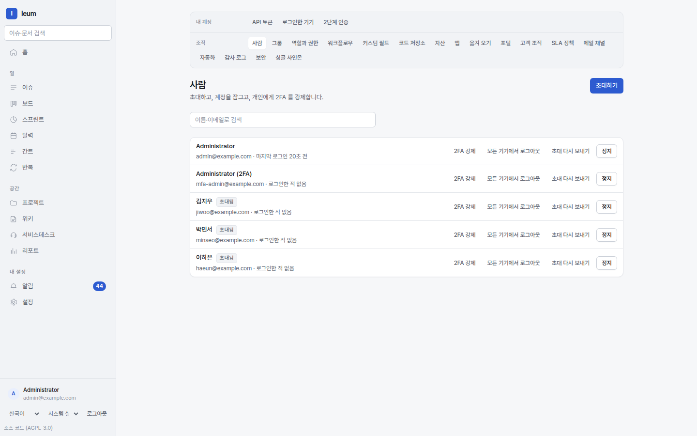

# Administration

Most of what an administrator works with lives under `Settings`: bringing people in,
deciding what they can do, and connecting Ieum to your company's sign-in.

`Settings → People`. Invitations, suspensions, and roles are all here.

## People

Invite people under `Settings → People`. They set their password from the link in the
invitation email.

**Suspend, don't delete.** Deleting someone removes the author from every issue, page,
and comment they created, and then the history can no longer be read. A suspended account
is only blocked from signing in.

Group people under `Settings → Groups`. Give roles to groups, and you won't have to
adjust roles one by one as people join and leave.

## Permissions

### Four layers of scope

| Scope | Applies to |
|---|---|
| **Global** | The whole installation |
| **Project** | That project and its subprojects |
| **Space** | The pages in that space |
| **Queue** | The tickets in that queue |

You **assign roles to a scope**. That's how someone becomes "an admin of this project
only". A role given on a parent project carries down to its subprojects.

### Nine built-in roles

The seed creates them. When a new release adds permissions, run `seed` again to fill
them in.

| Role | Where it applies |
|---|---|
| `Administrator` | Global. Everything |
| `Member` | Global. The default for anyone signed in |
| `Project Admin` / `Project Member` / `Project Viewer` | Project |
| `Space Admin` / `Space Editor` / `Space Viewer` | Space |
| `Desk Agent` | Project (Service Desk) |

To change permissions or create a new role, go to `Settings → Roles and permissions`.

### Per-object restrictions

Individual pages can be restricted for viewing and editing. Even someone with
permissions on the space won't see that page. Restrictions are inherited from the
**nearest ancestor**, so restricting a parent page closes off everything beneath it.

These restrictions **apply to search too** — restricted pages are left out of search
results and counts.

## Sign-in

### SSO

Connect OIDC or SAML 2.0 under `Settings → Single sign-on`. Accounts are created
automatically the first time someone signs in (JIT), and you can map your IdP's groups
to Ieum groups.

For SAML, Ieum verifies signatures and decrypts encrypted assertions. Download our SP
metadata and load it into your IdP.

### 2FA

Under `Settings → Security` you can require it for the whole organization. Once it's on,
people get the enrollment screen the next time they sign in.

- **Turning it on doesn't require 2FA** — otherwise an organization where nobody uses it
  yet could never turn it on.
- **Turning it off does** — you're removing protection, and by then everyone already
  has it set up.

Both TOTP apps and **passkeys** (WebAuthn) work. Backup codes are issued as well.

### Sensitive settings ask again

Settings that change security — roles, IdPs, workflows, webhooks, SLAs — don't open up
just because you're signed in. Only **a session that passed 2FA within the last 5
minutes** can change them; after that, the change is refused with "Confirm your
identity again to make this change." Sign in again and pass 2FA to unlock them.

The API follows the same rule. On a 403 `auth.step_up_required`, send a code again to
`POST /api/v1/auth/mfa/verify` with the same session. API tokens can't prove that a
person just confirmed, so they can't be used for these changes
(`auth.step_up_not_available_for_token`).

### SCIM

Issue a SCIM 2.0 token under `Settings → Single sign-on`, and your IdP pushes users and
groups in. It's the same standard Okta and Entra ID use.

## Security auditing

`Settings → Audit log` records who did what, and when. You can filter it and export it
as CSV.

`Settings → Devices` (under Your account) shows the devices you're signed in on right
now. You can revoke them one at a time, or **Sign out everywhere**. To end all of
someone else's sessions at once, use **Sign out everywhere** on `Settings → People` —
exactly what you need when someone loses their laptop.

## Workflows and fields

`Settings → Workflows` shows statuses and transitions. Each transition can require
fields and approvals.

Define fields under `Settings → Custom fields`. The field type decides what the input
looks like on screen.

## Integrations

| | |
|---|---|
| API `/api/v1/webhooks` | Sends events out. HMAC signatures, retries, automatic shutoff after repeated failures, and a delivery log (`/api/v1/webhooks/{id}/deliveries`). There's no web screen yet, so you register them through the API |
| `Settings → API tokens` | Personal access tokens, for scripts that call the API |
| `Settings → Apps` | Lets apps place things on screen |
| `Settings → Code repositories` | Attaches commits and PRs to issues |
| `Settings → Email channels` | Turns a mailbox into tickets |

Apps **don't send code.** The administrator picks where an app appears from a fixed
vocabulary, the app sends what to show as data, and our own components do the
rendering. So nothing an app sends can run in the browser.

## On to operations

Metrics, alerts, backups, upgrades, and running multiple instances are covered in the
[operations guide](../operations.md).
