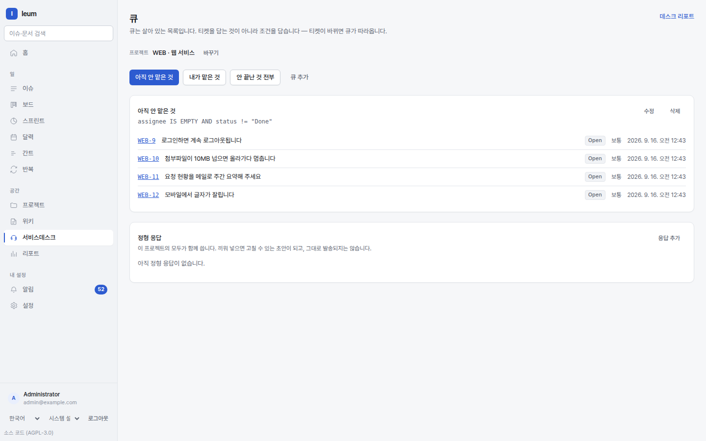

# Service Desk

## Tickets are issues

A request a customer files through the portal shows up for agents **as an issue**. That
means workflows, custom fields, search, and notifications work exactly as they do for
any other issue. The desk adds four things on top: the portal, queues, SLAs, and the
conversation with the customer.

## Portal

Create one under `Settings → Portals`. Each portal is attached to one project.

**Request types** are what the customer picks from. Each type defines what to ask (a
form), and the answers go into the issue's fields. "My laptop won't turn on" and
"Please create an account for me" need different questions, so they get separate types.

### What customers see

When customers open the portal address, it looks **different** from what a signed-in
agent sees. Customers:

- See only their own requests and their organization's requests
- Can't see internal notes
- Are **refused by default** everywhere outside the portal — opening the issue list or
  a wiki address with a customer account doesn't work. Nothing is open to them unless
  it's explicitly allowed (the portal and sign-in): **deny is the default**.

### Customer organizations

Group customers into an organization and they can see each other's requests. This is
for cases like three contacts at the same company who need to see each other's tickets.

## Queues

A queue is **a list defined by a condition**. The condition is written in IQL, and the
screen doesn't hide it — it's shown right above the list. When you wonder "why is this
ticket in this queue?", the answer is right there on the screen.

The top of `Service Desk` is where you pick a queue. Typical conditions are things like
"unassigned and not done", "from my organization", or "SLA about to be missed".

Queues are also a scope that permissions attach to. You can set up agents who see only
certain queues.

## Working with tickets

### Replies and internal notes

When you write a response, you choose one of two.

| | Visible to the customer | Sent by email |
|---|---|---|
| **Reply to customer** | Yes | Yes |
| **Internal note** | No | No |

The screen states plainly which one is the default, because picking the wrong one here
can't be undone — an email that has already gone to the customer can't be recalled.

### Canned responses

Keep answers you use often on the `Service Desk` screen, not in Settings — pick a
project and **Canned responses** appears below the queues, shared with everyone on that
project. On a ticket, pick one from **Insert a canned response** below the comment box.
What's inserted isn't sent as is; it becomes a draft you can edit.

### Knowledge base suggestions

Link a knowledge base space to a request type, and while the customer is writing a
request, the portal **suggests related pages.** It shows only the title and a one-line
excerpt; clicking one opens the page.

Only pages with **no restrictions at all** are suggested. A page with a view
restriction is never even a candidate.

## SLAs

You set up two things under `Settings → SLA policies`.

1. **Business calendar** — when are working hours? Targets are measured against this
   calendar. On weekends and holidays the clock stops.
2. **Policy** — what, and by when. For example, first response within 1 hour and
   resolution within 8 hours.

When you edit a policy, **you can't change what it measures (first response or
resolution).** Clocks that are already running would start measuring something else, and
the screen tells you why. To measure something else, make a new policy. The calendar can
still be changed when you edit.

### Pausing and escalations

In statuses that aren't on you, such as "Waiting for customer", the clock stops. You
choose which statuses pause it.

Escalations are rules like "notify the team lead at 70%" or "raise the priority when
breached". They can also kick in before a breach.

### Breaches are found by a sweep

A breach happens because **nothing happened**. There's no event to react to, so an event
can't tell you about it; instead, a worker periodically checks whether time is up. That's
why breach notifications arrive a few seconds after the target time.

**Overdue now** in the report also counts **breaches that haven't been notified yet** —
leaving out breaches the sweep hasn't reached would make the number wrong in the
flattering direction.

## Email channels

Connect a mailbox under `Settings → Email channels` and incoming mail becomes tickets.
Replies are grouped into the same thread, and bounces are recorded on the ticket.

If the sending address is on the same channel, the customer sees the conversation as one
continuous thread.

## Automation

Under `Settings → Automation` you build "when this happens, do that" rules — assign
someone when a particular request type comes in, raise the priority when a certain word
appears, and so on.

## Approvals

A request type can require approval.
A ticket waiting for approval **can be neither started nor closed** — the only ways
forward are approve, decline, or cancel.

Approvers don't need any permissions on the project (the approver list is what entitles
them). That's why decisions are made on the **home screen**, in the **Waiting for you**
card — someone without project
permissions has no reason to come looking through the desk.

Moving the status automatically after approval, and letting customers approve from the
portal, are **not available yet.**

## Satisfaction (CSAT)

When a ticket is closed, the customer receives a one-question survey. The link is a
signed, single-use address, so they can answer without signing in, and nobody else can
answer on their behalf.

## Assets (CMDB)

Register things like equipment, accounts, and licenses under `Settings → Assets`, and
link them to tickets. Then you can count "requests that came in about this laptop".

Assets **belong to the organization**, so their permissions are global. Asset types can
be archived: once archived, a type can't be given to new assets, but assets that already
have it keep it.

There are no free-form attribute columns — a field with no definition lets two people
record the same thing two different ways. JSM-style Assets, where asset types and
attributes are defined as data, isn't available yet.
