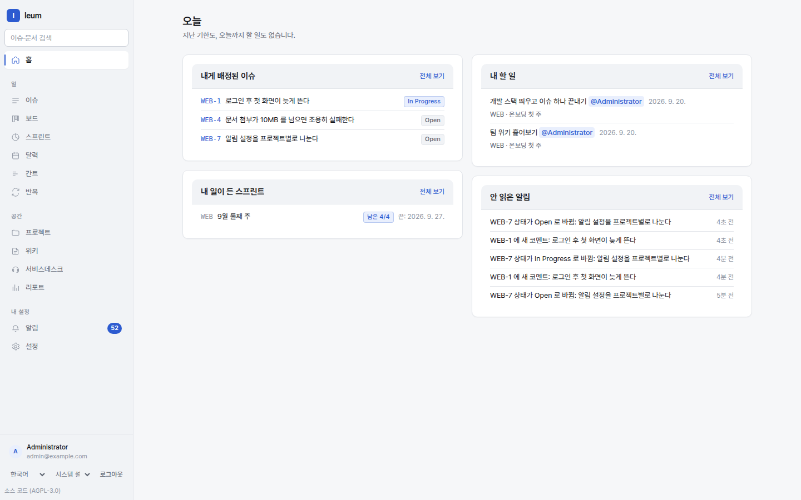

# Getting started

When you sign in, the **Today** screen comes up first. It gathers the issues
assigned to you, the tasks in pages that are yours, sprints that hold your
work, and your unread notifications on a single screen.

The menu on the left is split into **three groups** by what you do there.

| Group | Menu | What it is for |
|---|---|---|
| | **Home** | What has come your way right now |
| Work | **Issues** | List, search, bulk edit. Narrow it down with IQL |
| Work | **Boards** | Kanban. Drag cards to change status |
| Work | **Sprints** | Sprints and burndown |
| Work | **Calendar · Gantt · Repeats** | Three views of your schedule |
| Places | **Projects · Wiki** | Where work lives and where pages live |
| Places | **Service Desk** | The agent view. Queues and tickets |
| Places | **Reports** | IQL aggregates and Service Desk performance |
| You | **Notifications** | In-app notifications and watch settings |
| You | **Settings** | People, roles, workflows, portals, SLAs, integrations |

At the very bottom you'll find the account you're signed in with, plus
controls for **Language** and **Appearance** (Light / Dark / System).
Appearance is remembered in this browser only. On a large screen, the sidebar
button at the top (**Collapse sidebar** / **Expand sidebar**) folds or unfolds
the menu, and that choice also stays in this browser. On a narrow screen, tap
**Open menu** in the top left; tap outside the menu or press `Esc` to close
it. Search and new issue are also available straight from the top bar. On a
narrow screen, the search button or `/` opens the command palette. In the
issue list, open **View options** to change which columns are shown and how
rows are grouped.




The menu is on the left and today's work is in the middle. When a list is
empty, each section tells you why.

## Try it in 30 minutes

Do these three things and you'll see how the pieces of Ieum connect.

### 1. A project and your first issue

`Issues → New issue`. If you don't have a project yet, create one with
`Projects → New project`. The **Key** (for example `ENG`) becomes the prefix
of every issue number, and it never changes afterwards — issue keys
(`ENG-1`) end up in links, commit messages, and emails.

Once the issue exists, open `Boards` and drag the card to move it to another
status. The workflow decides where it is allowed to go.

→ [Issues and projects](issues.md)

### 2. A space and your first page

`Wiki → New space`. Create a page and put this in the body:

```
::issues[project = ENG AND status != Done]
```

Save it, and an **issue list is rendered as a table** right there. The page
knows about the issues, and from the issue side you can find the page that
mentions it.

→ [Wiki](wiki.md)

### 3. A portal and your first ticket

Create a portal under `Settings → Portals` and add a request type. Open the
portal's address in a browser and you're looking at **what the customer
sees** — it looks different from the signed-in agent view, and customers see
only their own requests.

Submit a request through the portal and come back to `Service Desk`: it has
arrived **as an issue**. When you answer, `Reply to customer` and
`Add internal note` are separate actions — internal notes are never shown to
the customer.

→ [Service Desk](desk.md)

## Things that save you some confusion

**Permissions attach to scopes.** There are four levels — global, project,
space, and queue — and you assign a role at a given scope. That's how someone
becomes "admin of this project only".

**Sensitive settings ask for 2FA again.** Places that change security, such
as roles, IdPs, workflows, and webhooks, don't open on sign-in alone; only a
session that passed 2FA within the last 5 minutes can touch them. The screen
asks you again when that happens.

**Every list is a search.** The issue list, queues, saved filters, the
`::issues` macro in pages — they all use the same IQL. A query you build in
one place can be pasted into another.

→ [Search and IQL](search.md)

**Inside the editor, `/` and `@` open a list.** `/` lists blocks you can
insert (table, code, callout box, table of contents, issue list …), and `@`
lists people. The point is that you never have to memorise directive syntax,
and both modes (**Write** and **Rich text**) use the same lists.

Fields where you type IQL suggest values as you go; `Esc` closes the list and
`Ctrl` (`Cmd` on macOS) `+Enter` runs the query.

**Four keys work everywhere.**

| Key | What it does |
|---|---|
| `Ctrl`/`Cmd` + `K` | Command palette — places to go, things to create, words to search, all in one box |
| `c` | New issue |
| `/` | Jump to the search box |
| `?` | Show this list |

In the issue list, `j`/`k` move between rows and `o` or `Enter` opens one.
On an open issue, `e` edits, `a` changes the assignee, `s` goes to status
transitions, and `p` goes to priority.
`?` shows **only what you can use right now**, so its contents differ from
screen to screen.
Close the palette and the help with `Esc` — while either is open, the
shortcuts behind it are paused, so pressing `c` with the help open won't take
you to the new issue screen.

`s` and `p` don't pick a value; they **take you to** the control — you choose
with the arrow keys and `Enter`. Single-letter keys are off inside a select
box, so after jumping there with `p` you have to leave the box before `s`
will work.

There are more than thirty screens, and twenty of them live under Settings.
The palette means you don't have to memorise them — type part of a name and
press `Enter`. If no name matches, it searches for what you typed.

**Single-letter keys are off while you're typing.** Typing "create" in a
comment won't make `c` open a new issue. The only shortcut that breaks
through is `Ctrl`/`Cmd`+`K`.

Everything else uses standard `Tab` and `Enter` navigation — a deliberate
choice not to make you learn different shortcuts on every screen, and it's
also where our accessibility goal points (we aim for WCAG 2.1 AA).
