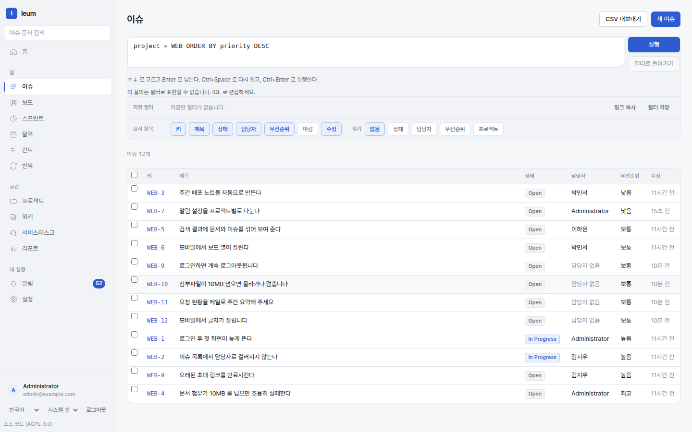
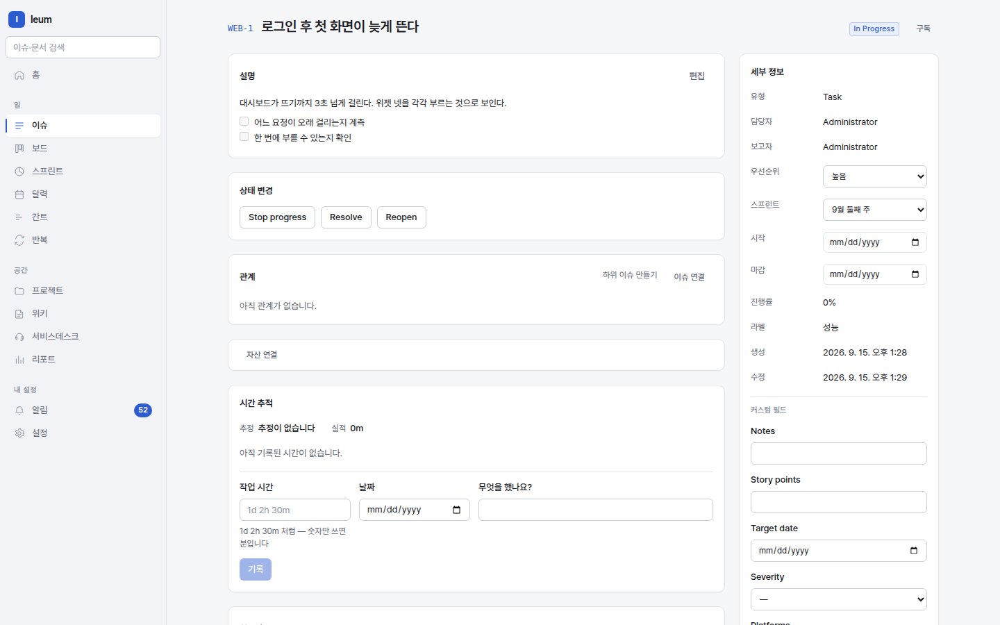

# Issues and projects

An issue is **one piece of work**. Bug, feature, or question, it's where the
record of who did what and when piles up. A project is where those issues
live, and where permissions are attached.

The issue list. The line at the top is IQL, and the list is the result of
that query.

A single issue. Status only moves through **the transitions the workflow offers** — you can't jump to just any status.

## Projects

A project is where issues live and **where permissions are attached**.
Projects can be nested, so you can split things up like
`Platform → Platform/Search`, and a role granted on a parent carries down to
its children.

**The key can't be changed.** If you create a project as `ENG`, its issues
become `ENG-1`, `ENG-2`, and those strings end up in links, commit messages,
emails, and webhooks. Change the key later and every one of those would lose
track of what it points to.

You can set the project lead and whether the project is public. Anyone who
is signed in can read a public project; a private one is visible only to
people who have been given a role.

## Issues

### Creating

`Issues → New issue`. Only the project and the summary are required. The
issue type (by default Task, Bug, Story, Sub-task) is paired with a workflow.

### Statuses and transitions

Status can only move **where the workflow allows**. The buttons you see are
exactly the places you can go; where you can't go, there's no button —
better than pressing one and being turned away.

There are two cases where a transition is blocked.

- **A required field** is empty — you're told which one.
- **It's waiting for approval** — the request type has an approval gate.
  Until the approval is approved, declined, or cancelled, the ticket can
  neither start nor finish.

### Relations and hierarchy

- **Sub-issues** count towards their parent's progress. Once every child is
  closed, the parent shows 100% progress, but **it is not closed
  automatically** — closing it is a human decision.
- **Relations** (blocks / is blocked by / relates to / duplicates) show up on
  both sides. Link from one side and it appears on the other.

### Time

Estimates and logged time are recorded separately. Write them like `2h 30m`
or `1d`. Each logged entry keeps its date and a note, so you can count them
up in reports later.

### Attachments

Drag and drop, or pick files. Files go to object storage **directly from the
browser** (they don't pass through the server); the server only hands out
signed URLs. That way, large files don't tie up the API.

### Comments and mentions

Mention someone with `@` and they get a notification. Notifications go out
both in the app and by email, and each person picks how they receive them
with the **Email** setting on the `Notifications` screen.

## Changing many at once from the list

Select issues in the issue list and a bar appears where you can **Set
priority**, **Add labels**, and **Remove labels** for all of them in one go.
**Leave the fields you don't want to change empty** — an empty field means
"leave it as it is", not "clear it". Changing the assignee or status (a
transition) in bulk as well is possible through the API
(`POST /api/v1/issues/bulk`).

`Export CSV` downloads exactly what the list is showing right now — change
the query and the export changes with it.

## Custom fields

Define them under `Settings → Custom fields`. The input on screen depends on
the field type (text, number, date, single choice, multiple choice, person,
version, yes / no, link).

In IQL you refer to a field you've defined as `cf["field_key"]`.

## Repeating issues

For work that comes around on a schedule, such as routine checks, create a
rule under `Repeats`. A worker finds the rules that are due and creates the
issues, and **the rule holds the template it creates from** — editing an
issue it created in the past doesn't affect the next one.

## Connecting code repositories

Register a repository under `Settings → Code repositories` and set up the
webhook, and commits and PRs whose message contains an issue key (`ENG-12`)
are attached to that issue.

**We never call the host's API** — we only receive. That means we don't hold
your tokens; the trade-off is that commits made while the webhook was off
won't be attached.

`fixes ENG-12` is **only recorded**; it doesn't move the status, because
commits can be reverted.
