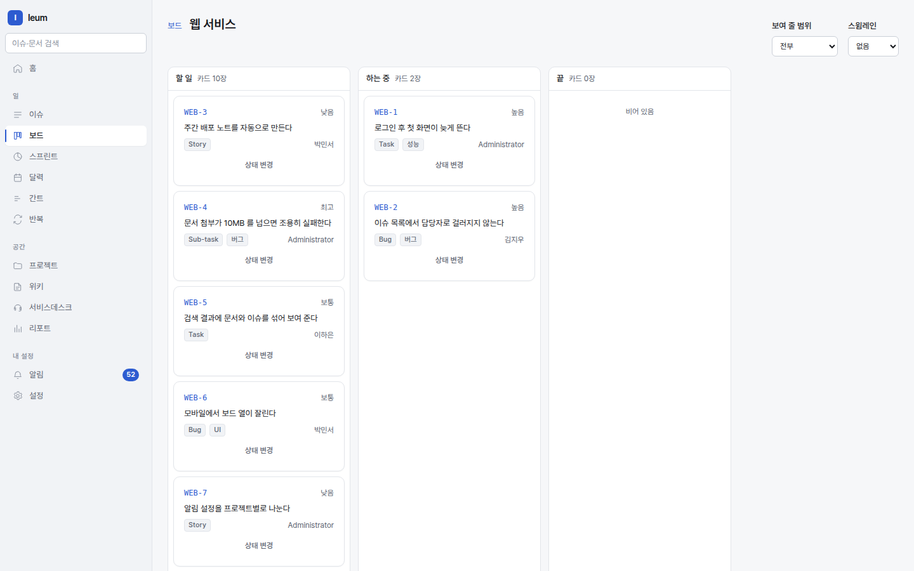
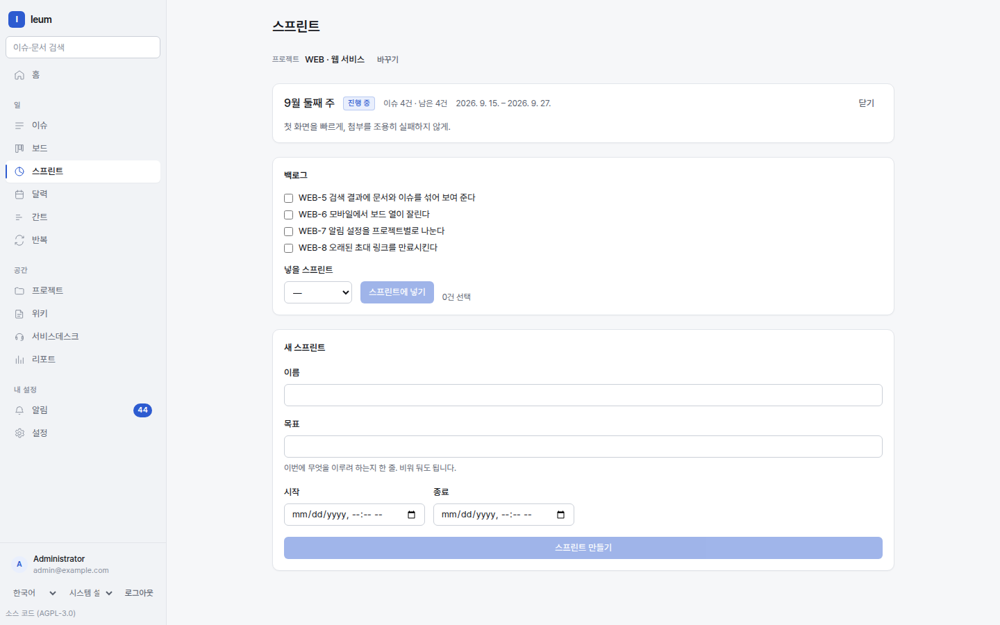

# Boards, sprints, and schedules

You can look at the same issues in four shapes. Pick one based on what you
want to see.

| Screen | The question it answers |
|---|---|
| **Boards** | What is stuck where right now? |
| **Sprints** | Is what we took on this cycle going to get done? |
| **Gantt** | What is waiting on what? |
| **Calendar** | When does this month get crowded? |




A kanban board. Columns are IQL too, so you write down what "In Progress"
means as a condition.

## Boards

Columns are statuses, and dragging a card to another column changes its
status. A card won't drop into a column it can't move to — that's the
workflow standing in the way.

**Swimlanes** split the board into rows. Choose Assignee, Priority, or Type,
and "who is holding what" or "where the urgent work is piling up" is visible
at a glance.

What goes on a board is decided by IQL. That's how you can keep separate
boards like "only my stuff" or "only this release".

## Sprints



Sprints and burndown.


Create a sprint in `Sprints`, add issues to it, and start it.

The **burndown** shows the remaining work shrinking. One point is plotted per
day, and **nothing is recomputed after the fact** — the value that was
actually remaining that day is stored that day. If you edit issues later, past
points don't move. That's what makes a burndown worth looking at (if it
quietly prettied itself up afterwards, there'd be no reason to look).

When you close a sprint, you **must** choose where unfinished issues go — the
next sprint or the backlog. There's no default, because quietly sending them to
the backlog would drop what you meant to do next into a place nobody looks.

## Gantt

Dependencies (blocks / is blocked by) are drawn as connecting lines. A bar
runs from the start date to the due date; if either one is missing, no bar is
drawn — we don't make up dates that aren't there.

## Calendar

Issues with a due date sit on their day. Drag one to another day and its due
date changes.

## Reports

`Reports` counts whatever you select with IQL, split by a single **Group by**
field (Status, Status category, Assignee, Reporter, Priority, Type, Sprint, or
Labels). You get things like count by status, unfinished issues per assignee,
or issues completed this month by type, as bars.

You can draw the same thing inside a page —
```
::chart{query="project = ENG" group=status}
```

Service Desk performance (SLA compliance, handling per agent) lives
separately under `Service Desk → Desk report`.

## My tasks

Checkboxes in a page body **count as tasks.** The assignee is the first
mention on the line (type `@` in the editor and pick a person), and the due
date goes after `due:`. A bare date couldn't be told apart from other dates in
the text.

```markdown
- [ ] Update the deployment doc [@Jihoon](user:<uuid>) due:2026-09-20
```

Saved like this (the editor inserts the mention in this form), it shows up in
Jihoon's `Wiki → My tasks` and on his first screen.

The source of truth is **the page's Markdown** — check an item off in the
list view and the page body changes. Edit the page, and the list follows.
Since there's only one copy, there's nothing to drift out of sync.
