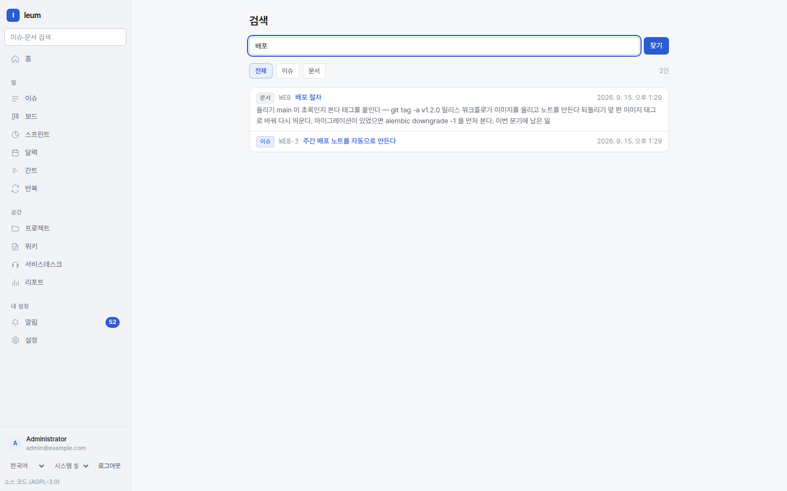

# Search and IQL

There is **one** search box. You don't have to choose between issues and pages first,
and when you want to state your conditions more precisely, the language you use is IQL.



Issues and pages come back together from one box. Korean text is indexed by morpheme.

## Searching from one box

The search box at the top finds **issues and pages together**. Korean is matched by
morpheme — searching for `배포` ("deploy") also finds text containing `배포를` and
`배포한`, inflected forms of the same word.

**Anything you don't have permission to see is never in the results in the first
place.** It isn't filtered out and hidden afterwards; permissions are built into the
query itself, so neither the result count nor a fragment of a title leaks.

Words separated by spaces must all appear (AND); split them with `OR` to match any of
them. `-word` excludes a word, and `"two words"` matches that exact phrase in that order.

## IQL — the language that defines lists

The issue list, boards, queues, saved filters, and the `::issues` macro in pages **all
speak the same language**. A query written in one place can be pasted into another.

```
project = ENG AND status IN ("In Progress", "In Review")
  AND assignee = currentUser()
  AND due <= endOfWeek()
  ORDER BY priority DESC, updated DESC
```

### Syntax

| | |
|---|---|
| Comparison | `=` `!=` `>` `>=` `<` `<=` |
| Contains | `~` (text contains) `!~` (does not contain) |
| Lists | `IN` `NOT IN` |
| Empty values | `IS EMPTY` `IS NOT EMPTY` |
| Grouping | `AND` `OR` `NOT` `( )` |
| Sorting | `ORDER BY field ASC|DESC` |

Keywords are case-insensitive. You can leave out the quotes if a value has no spaces or
special characters.

### Common fields

| Category | Fields |
|---|---|
| Basic | `project` `key` `type` `status` `statusCategory` (`todo`/`in_progress`/`done`) `priority` (1–5) `assignee` `reporter` `labels` `parent` `archived` |
| Text | `summary` `description` (search within them with `~`) |
| Dates | `created` `updated` `due` `startDate` `resolved` |
| Numbers | `estimate` `timeSpent` (minutes) `progress` (0–100) |
| Sprints | `sprint` `sprintState` (`future`/`active`/`closed`) |
| Custom | `cf["field_key"]` |

### Functions

`currentUser()` · `now()` · `startOfDay(±n)` · `endOfDay(±n)` ·
`startOfWeek(±n)` · `endOfWeek(±n)` · `startOfMonth(±n)` · `endOfMonth(±n)`

`endOfWeek(-1)` is the end of last week. If you don't type dates in by hand, a saved
filter stays correct as time goes on.

### Searching history

```
status WAS "In Progress" DURING (startOfMonth(), now())
status CHANGED AFTER startOfDay(-7)
assignee CHANGED TO currentUser() AFTER startOfDay(-7)
```

These are "was in this status at some point this month", "had its status
changed in the last 7 days", and "was handed to me in the last 7 days". Add
`FROM value` and/or `TO value` to `CHANGED` to narrow down where it changed
from and to, and give the time window as `DURING (start, end)`, `AFTER`, or
`BEFORE` with a date or a date function. History can be queried on `status`,
`assignee`, `reporter`, and `priority` only — fields whose history doesn't keep
a name would otherwise quietly match nothing instead of raising an error.

### When you get it wrong

**IQL points to exactly where the mistake is.** You don't just get an error message —
the offending word is underlined. It also suggests field names and values: open the list
with `Ctrl/Cmd+Space`, close it with `Esc`, and run the query with `Ctrl/Cmd+Enter`.

## Saved filters

Save a query and give it a name. **It's carried in the URL too** — you can copy a URL
that contains the query itself and send it to someone, and they see the results with
their own permissions (never with yours).

## When search doesn't work

- **Korean text isn't found** → Your Postgres may be missing the PGroonga extension.
  See the last section of the [installation guide](../install.md). It shows up as zero
  results rather than an error, so it's easy to miss.
- **Something you just created doesn't show up** → With the default setup it should
  appear **immediately**. If it doesn't, your installation may have switched the search
  backend to OpenSearch — that one catches up a few seconds later
  ([Operations, section 7](../operations.md)).
- **You searched for a lone `*`** → That isn't a word; it's a fragment of an operator.
  The default backend treats it as "a query it can't read" and searches for exactly
  what you typed.
