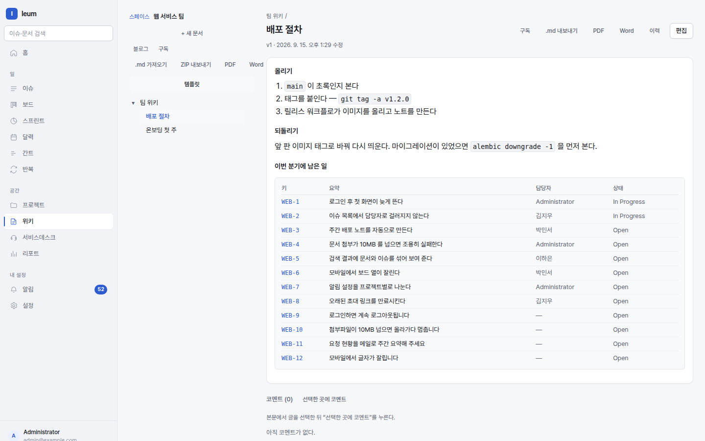

# Wiki

The wiki is **where your team's pages live**. It sits on the same search,
permissions, and notifications as issues, so a page can pull in issues and an
issue can find its way back to the page.

The `::issues` in the page body is rendered as a **live table**. It isn't a hand-written list; it's the result of a query run when you open the page.

## Spaces and pages

A space is where pages live and **where permissions are attached**. There
are three kinds.

- **Team** — an ordinary space for pages
- **Personal** — a space for your own pages. Only the label differs; it
  works the same as Team
- **Knowledge base** (KB) — a space whose articles Service Desk can suggest
  to customers

Pages form a tree. A page's path is `SPACEKEY/parent/child`, and that path is
its address.

## Writing

The editor has two modes. Both save **the same page as the same Markdown** —
a mode is only a way of looking at it.

| Mode | When to use it |
|---|---|
| **Write** | When you write Markdown directly, or fix a directive by hand |
| **Rich text** | When you build tables, or want pasted formatting kept as is |

`/` opens a list of blocks to insert. `@` mentions a person.

**Paste formatted text from elsewhere and it becomes Markdown.** Tables and
lists copied from Google Docs, Word, or web pages keep their shape. Code that
only has colour applied is left alone.

### Autosave

Whatever you're editing is saved automatically. It survives closing the
window, and when you open the page again your saved edit is loaded back, with
**Discard it** to throw it away. While you're connected for real-time editing,
your edits are saved into the **shared page**, so **anyone else editing that
page sees them** even before you publish ("Draft saved — shared with everyone
editing"). Meanwhile there's no separate **draft of your own** — if two drafts
competed over the same page, nobody could tell which one would come up next
time. Your own draft is used only when you couldn't connect. People who are
only reading the page don't see either until you publish.

## Writing together

When several people open the same page, you see each other's cursors and
names, and keystrokes merge in real time. No conflict dialog appears — the
text is a CRDT, so everyone ends up with the same result regardless of order.

!!! note "Text written before you connected"
    If you had already been typing before the socket connected, that text is
    **carried into** the shared page when the connection comes up. But if
    someone else edited the same page in the meantime, it isn't carried over
    and you're told instead — better for a person to look at two people's
    text than for a machine to blend it.

## Versions and comparison

Publishing creates a version. In `History`, pick two versions to compare them
line by line, and restore an older one if you need to.

**Autosave doesn't create versions.** If it did, the history would fill up
with a new line every three seconds.

## Comments

Select a passage and comment on it, and the comment is anchored there. When
the text changes, the comment **looks for a similar spot** and follows it.
If the text has changed too much for it to find one, it is marked as orphaned
(**Quote gone**) and collected at the bottom of the page — it never quietly disappears.

## Macros (directives)

Pull other things into a page.

| Write | What gets rendered |
|---|---|
| `::toc` | This page's table of contents |
| `::children{depth=2}` | A list of child pages |
| `::issues{query="project = ENG AND status != Done"}` | A table of IQL results |
| `::chart{query="project = ENG" group=status}` | A chart of an IQL aggregate |
| `::excerpt{page=ENG/deploy}` | The opening of another page |
| `:::info` … `:::` | A callout box (also `note`, `warning`, `danger`) |

A macro that can't be parsed **blocks saving.** That beats saving it and
seeing a broken box afterwards.

## Import and export

Upload a `.md` file and it becomes a page. Images linked by relative path are
**absorbed as attachments** — otherwise every one of those links would break.

Exporting gives you the `.md` files and their attachments in a single ZIP.
Export what you imported and you get the same thing back (a round trip).

You can also export to PDF and Word. Typesetting happens **inside the app**,
so no headless browser is needed, and Korean fonts ship inside the image.

## Blog

Every space has a blog. Posts don't go into the tree; they pile up **by
date**, which suits announcements and weekly notes.

## Notifications

Watch a page or a space and you get notified when it changes. You can choose
to get each one as it happens or **have them bundled** (a digest), and the
digest goes out according to the recipient's local time.
